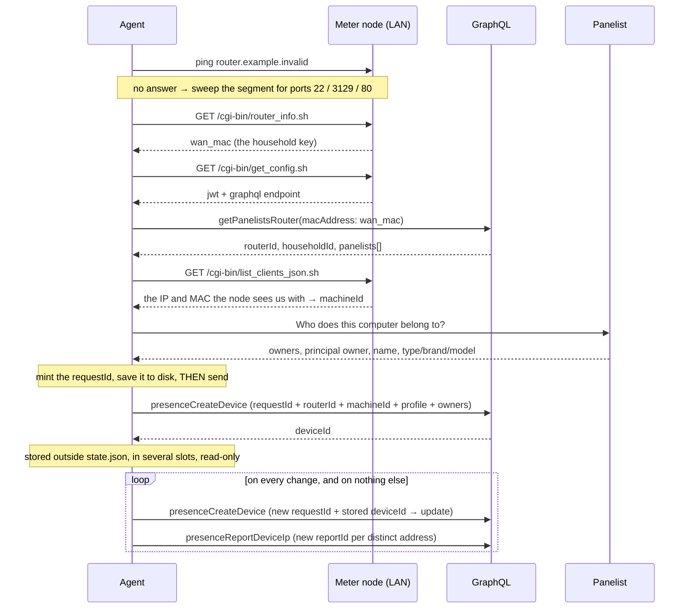

# How the agent works, end to end

This describes the flow as it runs with `sendToBackend` on, **which is now the default**.
With `{ "sendToBackend": false }` in a `config.json` the agent does every step below and
writes the requests to `Personicore-outbox.txt` instead of POSTing them.

Both mutations are deployed: `presenceCreateDevice` ([§4b of the
contract](GRAPHQL-CONTRACT.md)) and `presenceReportDeviceIp`. Neither carries the other's
field — the device write has no `ip`, the address report creates no subject — which is why
the default mode is `deviceAndIp` and why it is two calls in that order.

Everything here is the same on Windows and macOS. It lives in
`core/Personicore.DeviceAgent.Core`, and the two agents only draw it.

---

## The short version

```
install ─▶ find the meter node ─▶ read household + panelists ─▶ ask who owns this
        ─▶ register ─▶ keep the deviceId ─▶ report the IP on every change, and only then
```

## The long version



Two things in that diagram are easy to read past.

**The requestId is saved before the request leaves.** `presenceCreateDevice` keys retries
on it and on nothing else — not on `machineId` — so a create the server accepted but whose
answer never came back can only be reclaimed by resending the same key. Minting a fresh one
instead gives the household two Devices for one computer.

**The IP goes out separately or not at all.** `presenceCreateDevice` has no `ip` field. The
default `deviceAndIp` mode follows it with `presenceReportDeviceIp`, in that order, because
the address report never creates a subject to attach an address to. `device` mode sends the
device alone and reports no address at all; `deviceAndRouterIps` is for a backend without
`presenceReportDeviceIp`.

---

## 1. Find the meter node

Cheapest signal first, because the panelist's firewall notices bursts:

1. **ping** `router.example.invalid` — the node resolves that name for itself
   through dnsmasq, so an answer means it is in front of us.
2. if silent, **sweep the local segment** for an open port 22, 3129 or 80. A TCP connect
   is far cheaper than an HTTP request, so this turns hundreds of requests into a handful.
3. on those few candidates, `router_info.sh` decides: a candidate is only the node if it
   returns a valid MAC.

The node's `wan_mac` is the household key. Nothing else identifies the home.

**If there is no node**, the agent is a viewer: the status says *No meter node on this
network* and the only live menu items are *View details…* (which opens the log folder)
and *Refresh now*. Registering, the proxy and the start-with-the-session item are all
greyed out, because each of them depends on a node that is not there. The proxy switch
can always be turned **off**.

## 2. Read the household

`get_config.sh` hands over the `jwt` and the GraphQL endpoint — the agent has no
credential of its own and asks the panelist for none, it inherits the household's. The
token travels in `Authorization` **without a `Bearer` prefix**.

`getPanelistsRouter(macAddress)` then gives the three things the agent cannot know by
itself: the id the assignment is keyed on, the household id (this is the "filled in
automatically from the router" criterion — the panelist never types it) and the list of
people the computer can be attributed to.

**If the panel has nobody to assign to** — no router for that MAC, a router with no id,
or a household with no panelists — the agent stops on *Household not set up in the panel
yet*, tells the panelist **once** that Personicore support has to finish the setup and
that nothing is needed on this computer, and keeps retrying quietly. A reply that cannot
be parsed at all is an error instead, because that points at the wire, not at the panel.

## 3. Work out how the node sees this computer

`list_clients_json.sh` is the node's inventory of the bridge. The agent looks for the
entry whose IP matches the local route towards the node, and takes the **MAC from there**
rather than from the local adapter: the node reads it from its ARP table, and that is
what ends up indexing the traffic logs. The `machineId` is that MAC, encoded the way the
node encodes it.

## 4. Ask who it belongs to

A dialog with the real household list. It is asked once per household and computer: a
declared owner is only valid for the router and the machine it was declared on, so moving
to another router or changing the NIC asks again.

| Field | Where it comes from |
|---|---|
| Owners | checked from the household list |
| **Principal owner** | asked only when more than one is checked; one owner is the principal by being the only one |
| Name | the computer's name, editable |
| Type / brand / model | read from the machine, editable — many OEM BIOSes lie |
| Operating system | read-only: there the system's own answer always wins |

The identity block (IP, observed MAC, machineId) is shown but not editable: the MAC is
the key, and it is observed, not declared.

## 5. Register, and keep the identifier

The registration carries everything the criteria ask for:

```
ip · machineId · friendlyName · deviceType · deviceBrand · deviceModel · deviceOs
deviceShared · isPersonal · principalPanelistId · panelistIds
```

`isPersonal` is derived from sharing rather than asked — a computer one person uses is
personal, one that several people use is not — so the two answers cannot contradict
each other.

**The backend answers with the device's identifier**, and that is what the agent keeps:

- **outside `state.json`**, because the state file is what support tells a panelist to
  delete, and reinstalling is the other common reset. Losing the identifier that way
  would create a second device in the panel for the same computer.
- in **several slots at once** (the agent's folder, the machine-wide folder, the user's
  home), so wiping any one of them does not lose it. Whichever copy survives heals the
  others on the next start.
- **read-only and hidden**, so a cleanup does not take it by accident.
- **written durably**: to a temporary file, flushed to the disk, then renamed over the
  real one. A rename is atomic, so losing power leaves either the whole old value or the
  whole new one — never half an identifier, which would still look valid and be believed.
- **never replaced.** If the backend ever returns a different one, the first is kept and
  the difference is logged.

> It is not undeletable, and cannot be: the agent runs as the panelist, without
> elevation, so anything it can write that person can remove. Putting it genuinely out of
> reach needs an installer running as administrator, or widening the macOS root helper,
> which is deliberately limited to APPLY/REPOINT/RESTORE/OWNED/STATUS.

## 6. Keep the IP current

Three loops run, started and stopped together: the cycle (hourly) revalidates everything,
the proxy watchdog (30 s) follows the node's address, and the address watcher (30 s)
watches *this computer's* address. Only the cycle talks to the backend, and only when it
has something new to say:

| Reason in the log | When |
|---|---|
| `first report` | the first time after installing |
| `something changed` | a new IP, or a new owner, principal, name or hardware profile |
| `the clock moved backwards` | the clock jumped back, which would otherwise park the next report |

**There is no periodic report.** `reportIntervalSeconds` is 0: two identical reports a day
from a computer that has held the same lease all week tell the panel nothing. What makes
that safe is the address watcher — it resolves the local route with a connected UDP socket
(no packet, ~3 ms) and wakes the cycle within seconds of the address changing, without
depending on the OS raising a network event, which macOS does not always do. The
comparison is a fingerprint of everything that would be sent, so a corrected owner or a
renamed computer is not sat on either.

**Away from home** there is no node, so there is no credential and nothing to report to.
Nothing is queued: one report goes out on the next cycle after coming back, with the
address of that moment.

## 7. Four journeys

Everything above, in the order a panelist actually meets it. All of it is the same on
Windows and macOS.

### A. First run, no meter node

The node is looked for (name, then sweep) and nothing answers. The agent is a viewer:
*No meter node on this network*, and `ActionsUnlocked` is false — the menu offers only
*View details…* and *Refresh now*, and the setup assistant opens with all three steps
locked and says what it is waiting for. The certificate step is locked too although
installing it would work: it costs an administrator password, and spending one on a
network where the setup cannot continue is a prompt for nothing.

Nothing is queued and nothing is invented. There is no household, so there is nobody to
ask about — only `PERSONICORE_DRY_RUN` carries on without a node, and that is a developer's
mode, never a panelist's.

The one thing never locked is turning the proxy **off**.

### B. First run, with a meter node

Node → `wan_mac` → household and panelists → how the node sees this computer → the owner
dialog → `presenceCreateDevice` → the device id on disk → `presenceReportDeviceIp`. The
assistant opens at step one even when step one is already green, because the first run is a
walkthrough before it is a repair. After *Finish*, `setupCompletedAt` is recorded and it
opens on whatever is outstanding instead.

### C. Moving house, with a meter node in the new home

Three things are true at once here, and each is handled separately.

**The owner is asked again.** A declared owner is only valid for the household and the
computer it was declared on (`HasOwnerFor`), so the saved answer stops counting the moment
the node's MAC changes and the dialog reopens. The prompt is remembered per *household and*
computer: this computer's own MAC does not change when it is carried to another home, so a
key made of that alone used to say "already asked" and leave the panelist looking at
*Owner not set* with no dialog — which is what happens whenever the old node is simply gone
and the new one is discovered rather than revalidated.

**The device record does not move by itself.** `presenceReportDeviceIp` cannot move a
Network Device between routers; it answers *The Network Device is not registered on this
router*. That is a `DeviceOnAnotherNodeException` — the loop waits it out on the poll
interval, as it does any refusal no retry can fix, and the panelist is told *this computer
is registered on another Personicore router … support has to move it*, which is the one
sentence that lets them, or support, recognise what happened. It is said only on that
answer from the backend: locally, a move and a node record support recreated look
identical, and a headline must not describe a cause it is guessing at.

**The proxy does not follow the new node until this computer is registered on it.** Every
meter node answers to `router.example.invalid` through its own dnsmasq, and often at
the same address, so "a node answers" is not "our node answers": a laptop carried into
another panel household would otherwise have its traffic metered through that household's
node and filed under their home. So the MAC the node reports is checked against the
one kept with the registration — the node's own answer, not the backend's echo of the router
record — by the cycle, by the in-process watchdog, by the Windows scheduled task and by the
macOS root helper, which is told the MAC with every APPLY/REPOINT and keeps it for its own
watchdog. The switch stays on and reads *paused · the meter node here belongs
to another household*, and it comes back by itself once the owner has been declared here.
A computer that has never been registered has nothing to be foreign to, and uses the node
in front of it as before.

### D. Moving house, with no meter node in the new home — or just leaving

The status is the same as journey A, and the proxy is the whole of the difference:

| What removes the proxy | When |
|---|---|
| the cycle, `Sync(null)` | within the hour |
| the agent's proxy watchdog | within 30 s, backing off to 5 min while no node shows up |
| the OS watchdog — a scheduled task on Windows, a LaunchDaemon on macOS | within a minute, **with the agent not running at all** |
| *Quit* (`PauseForExit`) | at once |

Browsing comes first: the panelist's own previous settings go back, and never over a proxy
the agent did not set — a corporate proxy configured between two cycles is on some
networks the only way out. **The switch itself stays on**, and the difference between "we
paused it" and "the panelist turned it off" is recorded (the `proxy-paused.txt` marker on
macOS, the state file on Windows), because only one of those two comes back by itself.

Back home — or when the node reboots onto a new lease — the node is found again, the proxy
is re-pointed at its new address without waiting for the next cycle, and the cycle is woken
so the panel hears the address this computer now has.

`pkill` skips the clean exit. Quit from the menu, or let the per-minute watchdog notice.

## 8. What the panelist sees

| State | Meaning |
|---|---|
| *Registered · names* | assigned in the household, reporting |
| *Owner not set* | node and household resolved, nobody has said whose computer this is |
| *No meter node on this network* | away from home, or the node is off |
| *Household not set up in the panel yet* | the node answers, but the panel has nobody to assign to |
| *Registered · … · Personicore has still to finish this computer's own record* | the address and the owners landed, the Device row did not |
| *This computer is registered on another Personicore router* | the panel has it on the node of a previous home |
| *Simulated · …* | sending is held; the requests are in the desktop file |
| *Error: …* | the detail is in the log, and *View details…* opens the folder |

The menu is the same on both platforms, except for the one item that cannot be
(*Start with Windows* / *Start at login*). Every other line of text is shared in the Core,
so the two agents cannot drift apart in wording.

*Open the meter node…* opens the node's own page in the panelist's usual browser. The
address is the one the agent reached the node at —the IP when it was found by sweeping the
segment, `router.example.invalid` when the name answered— and never one read out of
what the node replied. Like the rest, it is greyed out with no node: away from home the
page is not there, and that name only resolves through the node itself.

## 9. The proxy, which is a separate switch

Independent of all the above except one thing: it points the system proxy at the node on
port 3129, pauses itself away from home and restores the panelist's own settings when
switched off or when the agent quits, and a watchdog does the same every minute even with
the agent not running — so a computer that leaves home never keeps a proxy pointing at an
address that is gone. Journey D above is the whole of that behaviour.

The one thing it is not independent of is **which** node. It only ever proxies through the
node this computer is registered on, checked by MAC at every level that can act on its own
(journey C). Until the first registration there is nothing to compare against and whichever
meter node answers is used, which is what makes the proxy usable during the first run.
